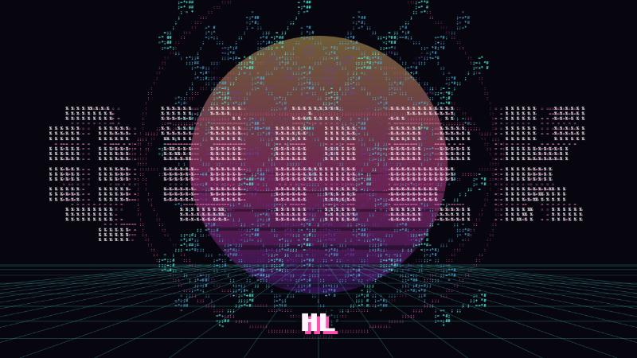
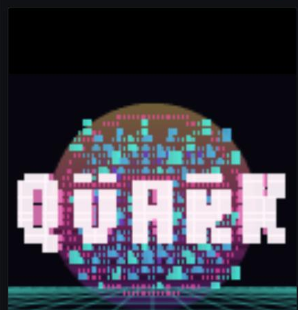

# Crystal Boot

*[English](README.md) · Français*

**[▶ Ouvrir l'appli](https://nktrois.github.io/crystal-boot/)**, rien à installer.

Des animations de démarrage pour tes appareils et tes services : une maille cristalline de diamant en ASCII, ton texte en relief, un soleil rétro et une grille qui file vers l'horizon. Exporte-la en **GIF**, en **vidéo** ou en **fichier pour ESP32 / Arduino** et joue-la sur un petit écran au démarrage de ton projet.



## Fonctionnalités

- **N'importe quel texte** dans le cristal, sur une ou deux lignes (lettres, chiffres et `- . ! ? ' : / & +` ; les accents sont retirés).
- **Signature HL** : la marque HL en bas, activée ou non.
- **Deux fins** : traversée du cristal, ou arrêt sur le texte.
- **Quatre palettes** : synthwave, ambre, terminal vert, glace. Soleil et grille désactivables.
- **Tailles d'écran** de l'OLED 128×128 au 1080p, ou une taille libre. Sur les petits écrans, les caractères deviennent du pixel art.
- **Exports** :
  - **GIF**, en boucle ou joué une fois ;
  - **vidéo**, MP4 ou WebM selon le navigateur ;
  - **`crystal_boot.h`** pour microcontrôleur (voir plus bas).
- **Mode kiosque** : `?kiosk=1` n'affiche que l'animation, en plein écran (pour un Raspberry Pi en kiosque, par exemple). Double-clic pour retrouver les réglages.
- **Lien partageable** : tous les réglages sont dans l'adresse.
- HTML, CSS et JavaScript simples : rien à installer, marche hors ligne, exports compris.

## Lancer

**En ligne :** [https://nktrois.github.io/crystal-boot/](https://nktrois.github.io/crystal-boot/)

**Copie hors ligne :** télécharger le dépôt (*Code → Download ZIP*), le dézipper et double-cliquer sur `index.html`.

Exemple : `https://nktrois.github.io/crystal-boot/?text=Quark&ending=hold&size=240x240` (ajoute `&hl=0` pour retirer la marque HL)

## Sur un ESP32 avec un écran

1. Dans la page, choisis la **taille de ton écran** (par exemple 128 × 128 pour un OLED SSD1351, 240 × 240 pour un ST7789), puis clique sur **ESP32 / Arduino (.h)**.
2. Mets le `crystal_boot.h` téléchargé à côté de [`examples/esp32-display/esp32-display.ino`](examples/esp32-display/), à la place de celui d'exemple.
3. Règle tes broches et le pilote d'écran en haut du croquis (SSD1351 et ILI9341 sont prêts), puis téléverse.

L'animation se joue au démarrage, puis ton programme démarre. Il suffit d'Adafruit GFX et du pilote Adafruit de ton écran : le fichier contient une palette RGB565 et des images compressées (RLE), lues directement en flash (aucune RAM utilisée).

Tailles mesurées pour 5 secondes avec la fin « arrêt sur le texte » :

| Écran | Réglages | En flash |
|---|---|---|
| 128 × 128 | 10 images/s, 32 couleurs | 320 Ko |
| 240 × 240 | 10 images/s, 32 couleurs | 660 Ko |
| 320 × 240 | 10 images/s, 32 couleurs | 850 Ko |
| 240 × 240 | 15 images/s, 64 couleurs | 1,5 Mo (demande le schéma de partition « Huge APP ») |

Un ESP32 standard a environ 1,2 Mo pour le programme. Réduis la taille, la durée, les images/s ou les couleurs si besoin.

L'exemple compile pour ESP32 (cœur Arduino 3.3) avec les deux blocs d'écran. Il **n'a pas encore été testé sur un vrai écran**.



## Tests

```bash
node --test tests/crystal.test.js
```

## Crédits et licence

Code : **MIT**, voir `LICENSE`. Encodage GIF par [gifenc](https://github.com/mattdesl/gifenc) (MIT, Matt DesLauriers), inclus dans `vendor/` avec sa licence.
