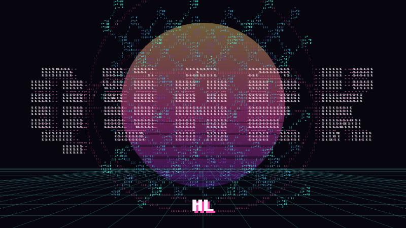
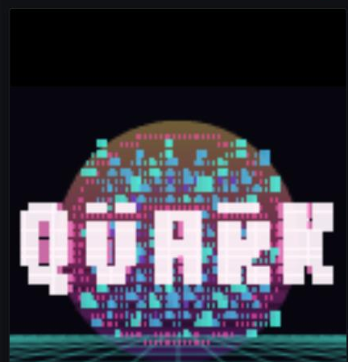

# Crystal Boot

*English · [Français](README.fr.md)*

**[▶ Open the app](https://nktrois.github.io/crystal-boot/)**, nothing to install.

Boot animations for your devices and services: a diamond crystal lattice in ASCII art, your text in relief, a retro sun and a grid racing to the horizon. Export it as a **GIF**, a **video**, or a **header file for ESP32 / Arduino** and play it on a small screen when your project starts.



## Features

- **Any text** in the crystal, on one or two lines (letters, digits and `- . ! ? ' : / & +`; accents are removed).
- **HL signature**: the HL mark at the bottom, on or off.
- **Two endings**: fly through the crystal, or stop on the text.
- **Four palettes**: synthwave, amber, green terminal, ice. Sun and grid can be turned off.
- **Screen sizes** from 128×128 OLED to 1080p, or any custom size. On small screens the characters turn into pixel art.
- **Exports**:
  - **GIF**, looping or played once;
  - **video**, MP4 or WebM depending on the browser;
  - **`crystal_boot.h`** for microcontrollers (see below).
- **Kiosk mode**: `?kiosk=1` shows only the animation, full screen (for a Raspberry Pi in kiosk mode, for instance). Double-click to bring the settings back.
- **Shareable link**: every setting is stored in the URL.
- Plain HTML, CSS and JavaScript: nothing to install, works offline, exports included.

## Run it

**Online:** [https://nktrois.github.io/crystal-boot/](https://nktrois.github.io/crystal-boot/)

**Offline copy:** download the repository (*Code → Download ZIP*), unzip it and double-click `index.html`.

Example: `https://nktrois.github.io/crystal-boot/?text=Quark&ending=hold&size=240x240` (add `&hl=0` to remove the HL mark)

## On an ESP32 with a screen

1. In the page, choose your **screen size** (e.g. 128 × 128 for an SSD1351 OLED, 240 × 240 for an ST7789), then click **ESP32 / Arduino (.h)**.
2. Put the downloaded `crystal_boot.h` next to [`examples/esp32-display/esp32-display.ino`](examples/esp32-display/), replacing the sample one.
3. Set your pins and screen driver at the top of the sketch (SSD1351 and ILI9341 are ready), then upload.

The animation plays at boot, then your program starts. It needs only Adafruit GFX and your screen's Adafruit driver: the file holds an RGB565 palette and run-length encoded frames, read straight from flash (no RAM used).

Sizes measured for 5 seconds with the "hold" ending:

| Screen | Settings | In flash |
|---|---|---|
| 128 × 128 | 10 fps, 32 colors | 320 KB |
| 240 × 240 | 10 fps, 32 colors | 660 KB |
| 320 × 240 | 10 fps, 32 colors | 850 KB |
| 240 × 240 | 15 fps, 64 colors | 1.5 MB (needs the "Huge APP" partition scheme) |

A standard ESP32 has about 1.2 MB for the program. Lower the size, duration, frame rate or colors if needed.

The example compiles for ESP32 (Arduino core 3.3) with both screen blocks. It has **not been tested on real hardware yet**.



## Tests

```bash
node --test tests/crystal.test.js
```

## Credits and license

Code: **MIT**, see `LICENSE`. GIF encoding by [gifenc](https://github.com/mattdesl/gifenc) (MIT, Matt DesLauriers), included in `vendor/` with its license.
